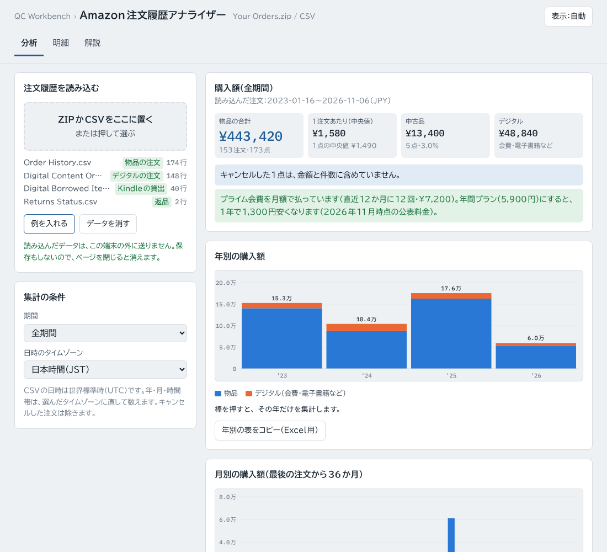
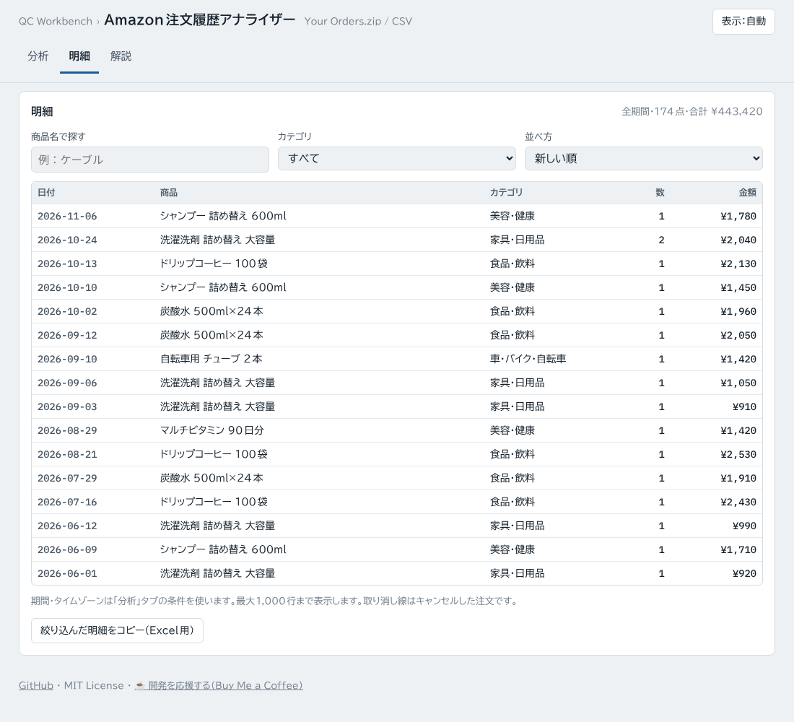

# Amazon注文履歴アナライザー（amazon-order-analyzer）

Amazonの「マイデータをリクエストする」で受け取った注文履歴のデータ（Your Orders.zip）を読み込み、**いつ・何に・いくら使ったか**を集計する Web ツールです。年別・月別の購入額、カテゴリ、リピート購入、高額の買い物、注文する時間帯、プライム会費とKindleの貸出をまとめて出します。

**https://kotaooka.github.io/amazon-order-analyzer/**

インストールは不要で、ブラウザで開くだけで使えます。

- **入力したデータやファイルは、この端末の外に送りません**。ファイルの読み込みと集計はすべてブラウザの中で行います。読み込んだ注文データは保存もしないので、ページを閉じると消えます（保存するのは期間などの表示の条件だけです）
- 画面の字体（BIZ UDPゴシック・IBM Plex Mono）は Google Fonts から読み込むため、開いたときに Google のサーバーへ接続します
- 一度開けば**オフラインでも動きます**。スマートフォンやPCにアプリとして追加することもできます。スマートフォンでは、読み込み欄のすぐ下に購入額の集計を表示します

スクリーンショットは「例を入れる」で作る架空のデータです。

---

## できること

### 読み込み

1. Amazon.co.jpの「[マイデータをリクエストする](https://www.amazon.co.jp/gp/help/customer/display.html?nodeId=G5NBVNN2RHXD5BUW)」で「注文履歴」を申し込み、メールで届くリンクから Your Orders.zip をダウンロードします
2. ZIPを展開せずに、画面に置く（または押して選ぶ）だけで読み込みます。中のCSVだけを選んでも読めます
3. 見出しでCSVの種類を見分けるので、ファイル名が変わっていても読めます。請求書のPDFなど、ほかのファイルは読みません

| 読むファイル | 使うところ |
|---|---|
| Order History.csv | 物品の注文（集計の中心） |
| Digital Content Orders.csv | デジタルの支払い（プライム会費、電子書籍など） |
| Digital Borrowed Items.csv | Kindle Unlimited・Prime Readingの貸出 |
| Returns Status.csv | 返品と返金額 |

### 分析

| 出力 | 内容 |
|---|---|
| 購入額 | 物品の合計・注文数・点数、1注文と1点の中央値、中古品の金額と割合、デジタルの合計。直近12か月では1か月あたり |
| 年別 | 物品とデジタルを積み上げた棒グラフ。棒を押すとその年だけを集計。Excel用にコピー |
| 月別 | 選んだ年の12か月、直近12か月、または最後の注文から36か月。点線は平均 |
| カテゴリ | Amazonの部門と商品名から分けた14の分類の金額・割合・点数 |
| 時間帯・曜日 | 注文した時刻と曜日の分布（日本時間・UTC・端末の時間を選べる） |
| リピート購入 | 同じ商品を2回以上買ったものの回数・合計・買う間隔（中央値） |
| 高額の買い物 | 金額の上位20点（中古・個数・カテゴリの印付き） |
| デジタル | 支払いの多いサービス、プライム会費の累計、月額プランなら年間プランとの差、Kindleの貸出、返品 |

### 明細

商品名・カテゴリで絞り込み、日付・金額・商品名の順に並べ替えて一覧にします。絞り込んだ明細はExcel用にコピーできます。

---

## 計算の定義

- 物品の金額は Order History.csv の「Total Amount」（商品ごとの支払額。税・送料・割引を反映）。空のときは（Unit Price ＋ Unit Price Tax）× 数量
- キャンセルした注文（Order Status が Cancelled）は除きます。通貨が複数あるときは、最も多い通貨の注文だけを足します
- 点数は CSV の行の数、注文数は Order ID の種類の数です
- デジタルの金額は Digital Content Orders.csv の「Transaction Amount」の合計（本体と税の行を足す。返金はマイナス）
- CSV の日時（UTC）を選んだタイムゾーンに直してから、年・月・時間帯・曜日を数えます
- 直近12か月は、今の日時から365日さかのぼった期間です
- プライム会費は、商品名が「Prime」の支払いです。直近12か月に2回以上なら月額プランとみなし、月額600円 × 12 − 年間5,900円の差を出します（2026年11月時点の公表料金）

カテゴリの分け方などの詳しい説明は、ツールの「解説」タブを見てください。

---

## 使うときの注意

- クレジットカードの請求額やギフト券の利用とは、締め日やポイント・ギフト券の扱いが違うので一致しないことがあります。定期おトク便の割引やポイントの還元は入っていません
- カテゴリは推定です。部門が空の商品は商品名の言葉で分けるので、間違えることがあります
- Amazonビジネスの購買データや、出品者としての売上は扱いません
- Amazonの書き出し方が変わってCSVの見出しが変わると、読めなくなることがあります。読み込めないときは、ファイルの一覧で「使わない」になっていないか確かめてください
- プライム会費の比較は、会費が変わるとツールの値を直すまで正しくありません

---

## 計算の検証

集計のもとになる公表値（規格や公表の表）はないので、`tests/test.js`（push のたびに GitHub Actions で実行）で、手で計算できる小さなデータを作って確かめています。

- CSV：BOM、引用符の中のカンマと `""`、セル内の改行、空のセル、空行
- ZIP：無圧縮と deflate の両方、CSV 以外を読まないこと、ZIP でないファイルのエラー
- 集計：8行の注文（同じ注文に2商品、Total Amount が空の行、キャンセル、別の通貨、部門が空の商品、UTC と日本時間で年がまたがる注文を含む）、7行のデジタル（返金を含む）、貸出、返品で、合計・点数・注文数・中央値・中古の割合・年別・月別・時間帯・曜日・カテゴリ・リピートの間隔・プライム会費の判定・期間の切り替え・タイムゾーンの切り替え。期待値はテストのコメントに計算を書いています（テスト全体で 62 項目）
- デモデータ：同じ種から同じデータができること、住所・支払い方法の列を含まないこと

開発者向けの情報は [DEVELOPMENT.md](DEVELOPMENT.md) にあります。

## ライセンス

[MIT License](LICENSE)
